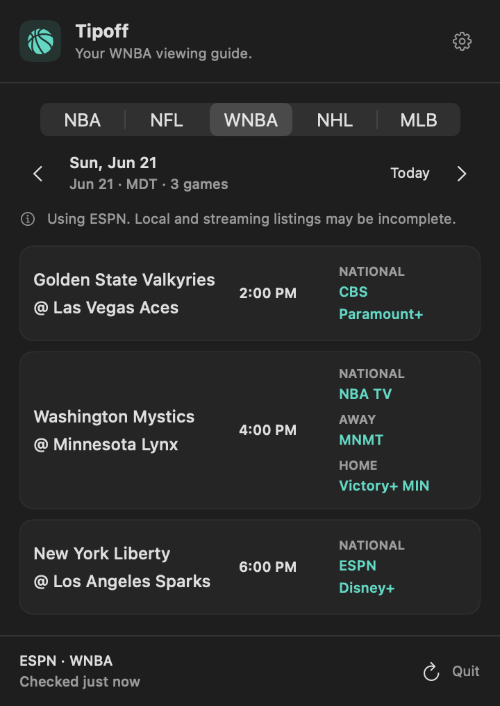

# Tipoff 🏀 🏈

**Who’s playing, when, and where can I watch?** A small native macOS menu bar app for NBA, NFL, WNBA, NHL, and MLB broadcast listings. No scores.

I built this because I was tired of checking the NBA schedule every day to figure out which channel or streaming service had a game. I’m a Nuggets and Broncos fan in Mountain Time, so there’s an Altitude-specific supplement for Nuggets games and highlighted Denver matchups in both guides.

This is a personal tool I’m sharing as it stands. If it’s useful, take it. If you want something different, fork it and have your agents—or yourself—make it work the way you want. There’s no product roadmap or promise of ongoing support. Bug reports and improvements are welcome, but you don’t need to wait on me to change your copy.



## What it does today

- Switches between NBA, NFL, WNBA, NHL, and MLB in the same 360-point popover; no Dock window. The menu bar icon follows the selected sport.
- All five sports show the selected day, with 28×28-point clickable areas around the previous/next arrows. Nuggets games appear first on NBA days; Broncos games appear first on NFL days.
- NFL’s Sunday shortcut jumps to the upcoming Sunday (or today on Sunday); the other sports keep their Today shortcut. The Sunday shortcut is hidden while viewing a Sunday.
- Highlights Nuggets matchups within NBA and Broncos matchups within NFL with a mint outline and team label; teams do not have separate sport tabs.
- Keeps each game in three columns: stacked teams, local time, and TV/streaming listings.
- Follows your Mac’s time zone, including daylight saving changes.
- Adds source-listed Altitude, Altitude 2, Altitude+, and channel 9/20 information for Nuggets games. Details include pregame/postgame times and regional notes.
- Refreshes when opened, after wake, and every five minutes while running.
- Keeps an offline copy and shows source/freshness information.
- Offers launch at login, off by default.

Radio is hidden. There are no scores, standings, live game clocks, notifications, or automatic updates. Broadcaster watch links are a future possibility.

## Try it

Requires **macOS 15 or newer**. The downloadable build is **Apple Silicon (arm64)**, built and tested on my Mac. Intel Macs can try building from source; I haven’t tested them.

[Download the published v0.2.0 (NBA-only)](https://github.com/jimmytheghost/tipoff/releases/tag/v0.2.0) · [All releases](https://github.com/jimmytheghost/tipoff/releases)

Unzip `Tipoff.app`, move it to your Applications folder, and open it. Click the basketball in your menu bar. To update an existing copy, quit Tipoff before replacing it.

The shared build is ad-hoc signed and **not notarized**. macOS may block a downloaded copy. Building locally is another option. There is no installer or update service, and no account or API key is required.

## Build it yourself

The app icon is also available as a 2048×2048 PNG with transparency at [`img/Tipoff.png`](img/Tipoff.png).

Install Apple’s Xcode Command Line Tools first (`xcode-select --install` if needed). The current version was built with Swift 6.3.3. No third-party Swift packages are required.

```sh
git clone https://github.com/jimmytheghost/tipoff.git
cd tipoff
scripts/test.sh
scripts/package-app.sh
mkdir -p ~/Applications
ditto dist/Tipoff.app ~/Applications/Tipoff.app
open ~/Applications/Tipoff.app
```

Quit an existing Tipoff instance before copying a replacement. `swift build` also builds the development tools. Packaging uses ad-hoc signing unless you set `TIPOFF_SIGNING_IDENTITY` to a signing certificate available on your machine.

## Where it’s at

Version 0.4.0 includes NBA, NFL, WNBA, NHL, and MLB viewing guides, with Nuggets and Broncos emphasis within their guides, focused on source-provided US broadcast listings. Build from source for this version; the linked v0.2.0 download is NBA-only. The Nuggets supplement and Denver team emphasis are deliberately built in for my own use, rather than a general favorites or location system. You can change that.

NBA.com supplies NBA data, ESPN supplies NFL and WNBA listings, and NHL.com and MLB.com supply their league schedules. ESPN is the NBA/NHL/MLB fallback. Altitude’s schedule supplements matching Nuggets games. These are public website endpoints, not guaranteed APIs. They can change or stop working. Listings can be incomplete, and a listed channel or service does not mean your subscription or location can receive it. Altitude’s Denver/outer-market restrictions are preserved in Details.

Tipoff doesn’t guess missing broadcasters or League Pass eligibility. Times come from the sources and use your Mac’s time zone. A failed refresh retains saved listings with a visible warning. “Checked” means the app retrieved the data, not that a broadcaster reconfirmed it.

No analytics or app account. Local schedule caches live under `~/Library/Application Support/Tipoff/`. The app makes network requests to its schedule sources. [Source details and cache behavior](docs/DATA.md).

## Known issues

Some local TV and streaming options are missing from the upstream listings, including NFL local-market coverage and streaming options in NHL’s TV feed. NFL times and networks can change through flex scheduling. The Altitude supplement adds coverage for matching Nuggets games, but listings for other teams can still be incomplete. If an option is missing, check the broadcaster’s own schedule before assuming the game is unavailable.

## Make it yours

Start with [AGENTS.md](AGENTS.md). It describes the existing behavior, design choices, and validation commands so you or your agents can get oriented.

- `Sources/Tipoff/`: menu bar app entry point.
- `Sources/TipoffCore/TipoffMenuView.swift`: the popover and broadcast details.
- `Sources/TipoffCore/ScheduleProvider.swift` and `FeedDecoder.swift`: NBA/NFL/WNBA fetching and ESPN decoding.
- `Sources/TipoffCore/LeagueFeedDecoder.swift`: NHL and MLB schedule/broadcast decoding.
- `Sources/TipoffCore/AltitudeSchedule.swift`: the personal Nuggets supplement.
- `Tests/TipoffTests/`: source fixtures and tests for matching, time zones, failures, and caching.

For a live source check:

```sh
swift run TipoffCheck 2026-10-24
swift run TipoffCheck 2026-10-25 --nfl
swift run TipoffCheck 2026-06-21 --wnba
swift run TipoffCheck 2026-10-22 --nhl
swift run TipoffCheck 2026-07-01 --mlb
.build/debug/TipoffCheck --render /tmp/tipoff-preview.png
```

The check writes a snapshot to `/tmp/tipoff-preview.png.json`; the renderer uses it without another network request. Add `--light` before the image path for light mode, or `--altitude-details` to preview a matched Nuggets game’s details.

[WNBA / MLB / NHL source research](docs/SOURCE-RESEARCH.md) · [What’s implemented / possible next steps](docs/PLAN.md) · [Validation and remaining manual checks](docs/VALIDATION.md) · [WNBA view](docs/wnba-preview.png) · [NHL view](docs/nhl-preview.png) · [MLB view](docs/mlb-preview.png) · [NFL view](docs/nfl-preview.png) · [Nuggets first](docs/nuggets-first-preview.png) · [Altitude details](docs/altitude-details.png)

## License

The code is [MIT licensed](LICENSE): use it, change it, and share it. It’s provided as-is. Third-party schedule data, names, and marks remain with their respective owners; see [NOTICE](NOTICE). Tipoff is not affiliated with or endorsed by the NBA, NFL, WNBA, NHL, MLB, ESPN, Altitude, or any team or broadcaster.
