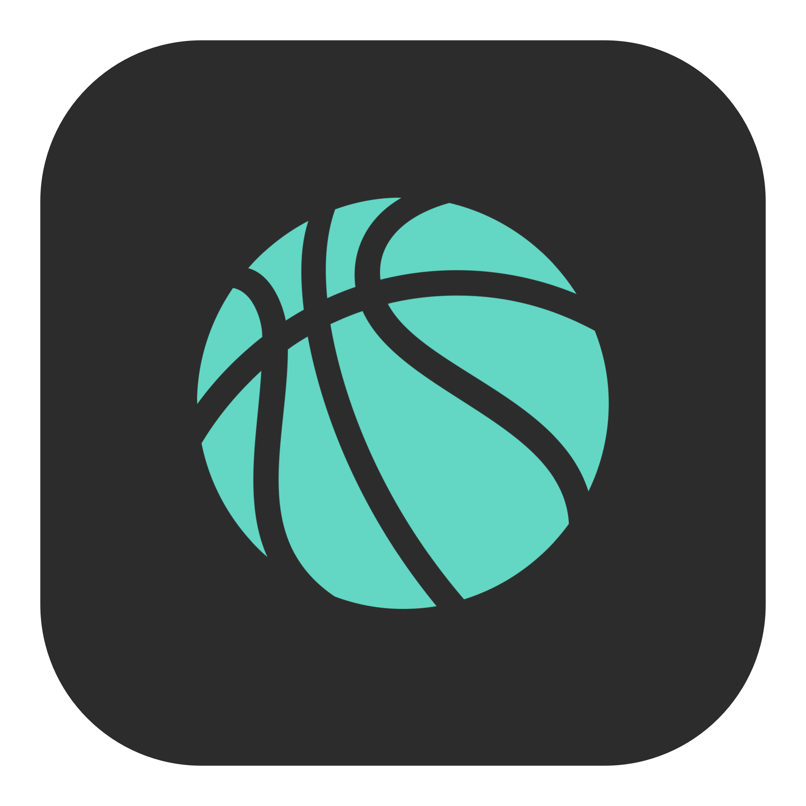

# Tipoff · macOS & Windows

**Who’s playing, when, and where can I watch?** A small native macOS menu bar and Windows system-tray app for NBA, NFL, WNBA, NHL, and MLB broadcast listings. No scores.

I built this because I was tired of checking the NBA schedule every day to figure out which channel or streaming service had a game. I’m a Nuggets and Broncos fan in Mountain Time, so there’s an Altitude-specific supplement for Nuggets games and highlighted Denver matchups in both guides. The Rockies and Avalanche get the same treatment in MLB and NHL.

This is a personal tool I’m sharing as it stands. If it’s useful, take it. If you want something different, fork it and have your agents—or yourself—make it work the way you want. There’s no product roadmap or promise of ongoing support. Bug reports and improvements are welcome, but you don’t need to wait on me to change your copy.



| Platform | App | Install the current version |
| --- | --- | --- |
| Windows 10/11 (x64) | Native C# / WPF system-tray app | [Install from source with PowerShell](#install-on-windows) (.NET 9 SDK required) |
| macOS 15+ | Native SwiftUI menu bar app | [Build from source](#build-the-macos-app) (Apple Silicon tested) |

The current source includes all five sports on both platforms. The only published download, [v0.2.0](https://github.com/jimmytheghost/tipoff/releases/tag/v0.2.0), is an older **macOS-only, NBA-only** build; there is no published Windows binary yet.

The web guide is live at [JimmyWeber.com/tipoff](https://www.jimmyweber.com/tipoff). The previous `/tip-off` address and [JimmyWeber.com/sports](https://www.jimmyweber.com/sports) redirect to the same guide.

To try the browser guide locally on macOS, run `scripts/preview-web.sh` with Python 3.9 or newer and open [the local schedule](http://127.0.0.1:8765/tipoff). The guide opens to today’s Following and National Broadcasts using the browser’s time zone. Following currently includes the Nuggets, Broncos, Avalanche, and Rockies. A followed game with national coverage appears once in the highlights and carries a National marker. Highlight cards reuse the full schedule’s header: name, National marker when applicable, and displayed game count aligned on one baseline. The status summary uses small bold uppercase text with spaced letters, and the empty-national-broadcast message uses the same treatment in a fainter color. Source, freshness, saved/fallback labels, loading/errors, and Altitude supplement warnings appear once per sport in the small borderless status disclosure on the right of the footer. It stays collapsed by default, with the status message/date/time and + control vertically centered on the right of the footer. Details open upward in a floating container; Escape or clicking outside closes it. Its summary shows “All schedules loaded” with the local completion date/time, or loaded/error counts while loading or on failure; saved-data labels and original source timestamps remain in the expanded details. Open **All Games** for the complete schedule and league filters; filters only affect that section. The landing view omits the page title and subtitle. The top heading is Following only when followed games are listed; otherwise it is National Broadcasts when national games are listed. Empty national sections hide their large heading and retain only the faint “No national broadcasts listed.” message after successful loading, with a compact 0.75 rem gap before All Games. On desktop (at least 64 rem wide), date controls sit between the logo and back link in the header. On tablet and mobile they span the content width above the section heading in the page body. Click the plain-text date button to open a calendar matching the guide’s dark surface and lime accent. It includes month arrows, a Today shortcut, keyboard day/month navigation, and Escape/click-away dismissal. Changing the date updates both views; Today and the arrows keep the picker synchronized. The date toolbar uses a thin baseline in the body, muted previous/next arrows, and a subtly outlined Today button; its controls retain 44 px targets and keyboard focus styling. On screens up to 24 rem wide, Today stacks above the unbroken date; wider layouts keep it inline. The footer sits at the viewport bottom on short pages and follows expanded content on long pages, leaving no space beneath it. The time zone remains inside All Games. Empty leagues appear collapsed at the bottom of All Games. Select any other game to reveal its broadcast details. In the full schedule, followed games have blue outlines and other national games have lime outlines. The web guide shows source-listed TV and streaming listings. League passes and select league networks, including NFL Network / NFL Net, stay out of national highlights. Across all five sports, each matchup shows full names when both fit in its available space (for example, Denver Broncos @ Carolina Panthers), then removes city/state prefixes when needed (Broncos @ Panthers). When even shortened names do not fit and both logos are loaded, the matchup becomes just the two logos separated by @, with the logos enlarged from 1.4 to 1.8 rem. Full names remain accessible and available on hover; failed or missing logos retain text. The choice updates on resize, logo load/failure, and when hidden schedules open. NBA nicknames receive their official full display names; unknown names remain intact. Full display names remain on hover and original source names remain unchanged in snapshots. Network logos use proportion-based image boxes with shared 3 rem width / 1.4 rem height caps and the same 8-pixel spacing throughout; inline groups stay on one horizontal line within the fixed network column, shrinking proportionally only when needed. Expanded broadcast lists can still wrap. NBC uses white lettering with its colored peacock, and ESPN uses a clean white wordmark; team logos use that same gap before their names. Team artwork prefers ESPN’s published dark-background variants across all five sports, with the original artwork as a fallback; MLB numeric team IDs map to the corresponding artwork without changing source data. National broadcaster logos use a consistent-width column before the matchup, aligning away-team logos across rows regardless of network count, on the same row as the start time, with long team names shortened visually when space is limited (full names remain accessible and available on hover); Following rows use that same fixed broadcaster column, matchup, and start time. They show national broadcasters when present; otherwise they show a source-listed Altitude / Altitude 2 network (preferring the matched Altitude guide), or the first listed video broadcaster. Expand a Following row for all original video listings, regional labels, Altitude notes, show times, and original freshness. Other full-schedule broadcast listings remain below. Team and broadcaster logos, including Peacock, FOX, TNT, HBO Max, truTV, Altitude (also matched from ALT), Altitude 2, Altitude+, and NBA TV, retain accessible names and text fallback. The header and footer link home with Jimmy’s supplied skull artwork, tinted to the lime-yellow accent, with accessible back-link names. The header places the supplied basketball mark to the left of Tipoff, tinted to the site’s lime accent with transparent seams. The browser favicon uses the same basketball artwork in lime. NBCSN and NBC Sports Network listings share the distinct NBCSN logo with accessible source names. The approved redesign is live on JimmyWeber.com. A reversible flat-surface pass gives card headers and game rows one solid fill, with muted text for collapsed listings. A faint one-pixel stroke separates each shared card header from its game rows. See [flat-style rollback](docs/FLAT-STYLE-ROLLBACK.md). See the [website handoff](WEBSITE-HANDOFF.md) for production integration.

On the live guide, saved schedules load immediately with their original timestamps while refreshes run in the background. Refresh locks are isolated by sport, date, and time zone. A date with no saved data returns a pending response that the browser polls for up to 95 seconds; individual HTTP attempts time out after 8 seconds. A source failure never turns a missing schedule into “No games scheduled.” Return to the date or select Today to read a completed background refresh.

## What it does today

- Switches between NBA, NFL, WNBA, NHL, and MLB in a compact 360-unit guide, opened from the macOS menu bar or Windows system tray. On macOS, the menu bar icon follows the selected sport; Windows uses a basketball tray icon.
- All five sports show the selected day, with 28×28-point clickable areas around the previous/next arrows. On macOS and Windows, NBA games with source-listed national TV/streaming broadcasters appear before League Pass and regional-only listings; Nuggets lead within each group. Broncos, Avalanche, and Rockies games lead NFL, NHL, and MLB respectively.
- NFL’s Sunday shortcut jumps to the upcoming Sunday (or today on Sunday); the other sports keep their Today shortcut. The Sunday shortcut is hidden while viewing a Sunday.
- Windows date arrows match macOS: borderless chevron icons with invisible 28×28 click targets, tooltips, and accessible names.
- Highlights Nuggets, Broncos, Avalanche, and Rockies matchups within their sports with a mint outline and team label; teams do not have separate sport tabs.
- Keeps each game in three columns: stacked teams, local time, and TV/streaming listings. On Windows, the Altitude Details toggle sits beneath the time inside the main row; expanded information fills the card below only when opened.
- Follows your computer’s time zone, including daylight saving changes.
- Adds source-listed Altitude, Altitude 2, Altitude+, and channel 9/20 information for Nuggets games. Details include pregame/postgame times and regional notes.
- Refreshes when opened, after wake, and every five minutes while running.
- Keeps an offline copy and shows source/freshness information.
- On macOS, offers launch at login, off by default. On Windows, starts in the tray at sign-in after the first launch; Settings or the tray menu can turn this off.

Radio is hidden. There are no scores, standings, live game clocks, notifications, or automatic updates. Broadcaster watch links are a future possibility.

### Windows system-tray app

The repository includes a native C# / WPF system-tray app under `Windows/`. Its 360-unit flyout includes the same five sport guides, compact game cards, local calendar-day navigation, NFL Sunday shortcut, Denver/Colorado display priority, source and freshness labels, explicit fallback labels, and isolated offline snapshots. Light mode uses deep teal for game-card text; Dark mode matches the macOS reference with charcoal surfaces, soft white text, gray secondary text, and bright mint accents. Routine coverage disclaimers do not occupy the compact UI; actual refresh, saved-data, and Altitude problems remain visible. Empty preferred-team and game-notice fields do not reserve vertical space. The 36-unit header has a small basketball mark, the Tipoff name, and a borderless gear icon. Left-click the tray icon to toggle the flyout; right-click for Open, Refresh, and Quit. The first launch opens the flyout so the tray behavior is discoverable.

The Windows app uses the same source hierarchy and keeps only schedule/broadcast fields. NBA games with source-listed national TV/streaming broadcasters appear before League Pass and regional-only listings; Nuggets lead within each group. It also applies the personal Altitude Nuggets supplement only when the date, opponent, home/away designation, and tipoff agree; expandable Details preserve Altitude’s network labels, pregame/postgame times, regional footnotes, and supplement freshness. A failed Altitude refresh uses its separately saved listings when available without replacing the primary NBA schedule. Automatic matching of the Windows appearance, a conventional signed installer, and automatic updates are not included yet. This is a source build, not a published Windows release.

## Install on Windows

The current Windows app is installed from source. It needs **64-bit Windows 10/11**, Git, and the **.NET 9 SDK**. If needed, install both from Windows Package Manager:

```powershell
winget install --id Git.Git -e
winget install --id Microsoft.DotNet.SDK.9 -e
```

Then clone and install Tipoff from PowerShell:

```powershell
git clone https://github.com/jimmytheghost/tipoff.git
Set-Location tipoff
powershell -ExecutionPolicy Bypass -File .\scripts\install-windows.ps1
```

The script builds the current app, installs it to `%LOCALAPPDATA%\Programs\Tipoff`, adds a **Tipoff** shortcut to the Start Menu, and launches it. The first launch configures Start with Windows; an existing explicit opt-out is preserved. No administrator access, account, or API key is needed after the prerequisites are installed. To update later, run `git pull` in the clone and run the installer script again.

Click the **gear icon** in the guide header for **Light / Dark** appearance, **Start Tipoff with Windows**, and **About Tipoff**, or right-click the tray icon for **Settings / About Tipoff**. Appearance changes apply immediately to the guide and Settings and are saved for the next launch; Light is the initial default. Settings reports whether the current executable is registered and includes a shortcut to Windows Startup Apps, where Windows may separately disable it. At sign-in, Tipoff starts in the notification area; click its icon to open the guide, checking the hidden-icons arrow if needed. If startup stops working after moving or deleting a development build, run the installer above and enable startup from the installed copy.

There is no published or code-signed Windows binary yet. Do **not** install the GitHub `v0.2.0` release on Windows—it is the older macOS NBA-only build.

### Hand this repository to an agent

Give the agent the repository URL and this instruction:

> Install the current Windows version of Tipoff from source. Follow the README and `AGENTS.md`, use `scripts/install-windows.ps1`, verify that Tipoff is running from its installed location, and do not modify the app’s source code.

Claude Code also has a small [`CLAUDE.md`](CLAUDE.md) routing file; the canonical project constraints remain in [`AGENTS.md`](AGENTS.md).

## Install on macOS

Requires **macOS 15 or newer**. The downloadable build is **Apple Silicon (arm64)**, built and tested on my Mac. Intel Macs can try building from source; I haven’t tested them.

[Download the published v0.2.0 (NBA-only)](https://github.com/jimmytheghost/tipoff/releases/tag/v0.2.0) · [All releases](https://github.com/jimmytheghost/tipoff/releases)

Unzip `Tipoff.app`, move it to your Applications folder, and open it. Click the Tipoff icon in your menu bar (it follows the selected sport in current source builds). To update an existing copy, quit Tipoff before replacing it.

The shared build is ad-hoc signed and **not notarized**. macOS may block a downloaded copy. Building locally is another option. There is no installer or update service, and no account or API key is required.

## Build from source

The original app icon remains available as a 2048×2048 PNG with transparency at [`img/Tipoff.png`](img/Tipoff.png). The current Windows tray icon is generated separately during packaging.

### Build the macOS app

Install Apple’s Xcode Command Line Tools first (`xcode-select --install` if needed). The current version was built with Swift 6.3.3. No third-party Swift packages are required.

```sh
git clone https://github.com/jimmytheghost/tipoff.git
cd tipoff
scripts/test.sh
scripts/package-app.sh
mkdir -p ~/Applications
ditto dist/Tipoff.app ~/Applications/Tipoff.app
open ~/Applications/Tipoff.app
```

Quit an existing Tipoff instance before copying a replacement. `swift build` also builds the development tools. Packaging uses ad-hoc signing unless you set `TIPOFF_SIGNING_IDENTITY` to a signing certificate available on your machine.

### Build the Windows app without installing

Install the .NET 9 SDK, then run PowerShell from the repository root:

```powershell
dotnet run --project Windows/Tipoff.Tests/Tipoff.Tests.csproj --configfile Windows/NuGet.Config
scripts/package-windows.ps1
dist/windows/Tipoff.exe
```

The framework-dependent x64 package requires the .NET 9 Desktop Runtime. It is intentionally package-free and does not contact NuGet. Packaging regenerates both the multi-size tray ICO and a 256-pixel flyout-header PNG from [`img/Tipoff-transparent.png`](img/Tipoff-transparent.png), then bundles the project license and notice. Daily caches live under `%LOCALAPPDATA%\Tipoff\Schedules\Windows\`; the Altitude supplement uses `%LOCALAPPDATA%\Tipoff\Altitude.Windows.json`. `Tipoff.Check` provides command-line live-source checks, for example `dotnet run --project Windows/Tipoff.Check/Tipoff.Check.csproj -- nfl 2026-10-25` or `dotnet run --project Windows/Tipoff.Check/Tipoff.Check.csproj -- altitude`.

## Where it’s at

Version 0.4.1 includes NBA, NFL, WNBA, NHL, and MLB viewing guides, with Colorado team emphasis within the appropriate guides, focused on source-provided US broadcast listings. The current macOS and Windows apps are built from source; the linked v0.2.0 download is macOS-only and NBA-only. The Nuggets supplement and Denver team emphasis are deliberately built in for my own use, rather than a general favorites or location system. You can change that.

NBA.com supplies NBA data, ESPN supplies NFL and WNBA listings, and NHL.com and MLB.com supply their league schedules. ESPN is the NBA/NHL/MLB fallback. Altitude’s schedule supplements matching Nuggets games. These are public website endpoints, not guaranteed APIs. They can change or stop working. Listings can be incomplete, and a listed channel or service does not mean your subscription or location can receive it. Altitude’s Denver/outer-market restrictions are preserved in Details.

Tipoff doesn’t guess missing broadcasters or League Pass eligibility. Times come from the sources and use your computer’s time zone. A failed refresh retains saved listings with a visible warning. “Checked” means the app retrieved the data, not that a broadcaster reconfirmed it.

No analytics or app account. Local data lives under `~/Library/Application Support/Tipoff/` on macOS and `%LOCALAPPDATA%\Tipoff\` on Windows. The app makes network requests to its schedule sources. [Source details and cache behavior](docs/DATA.md).

## Known issues

Some local TV and streaming options are missing from the upstream listings, including NFL local-market coverage and streaming options in NHL’s TV feed. NFL times and networks can change through flex scheduling. The Altitude supplement adds coverage for matching Nuggets games, but listings for other teams can still be incomplete. If an option is missing, check the broadcaster’s own schedule before assuming the game is unavailable.

## Make it yours

Start with [AGENTS.md](AGENTS.md). It describes the existing behavior, design choices, and validation commands so you or your agents can get oriented.

- `Sources/Tipoff/`: menu bar app entry point.
- `Sources/TipoffCore/TipoffMenuView.swift`: the popover and broadcast details.
- `Sources/TipoffCore/ScheduleProvider.swift` and `FeedDecoder.swift`: NBA/NFL/WNBA fetching and ESPN decoding.
- `Sources/TipoffCore/LeagueFeedDecoder.swift`: NHL and MLB schedule/broadcast decoding.
- `Sources/TipoffCore/AltitudeSchedule.swift`: the personal Nuggets supplement.
- `Tests/TipoffTests/`: source fixtures and tests for matching, time zones, failures, and caching.
- `Windows/Tipoff.App/`: WPF tray icon and 360-unit flyout.
- `Windows/Tipoff.Core/`: Windows models, strict source decoders, provider, and cache.
- `Windows/Tipoff.Tests/` and `Windows/Tipoff.Check/`: fixture validation and live checks.
- `scripts/generate-windows-icon.ps1`: generates the PNG-backed, multi-size Windows basketball icon.
- `scripts/install-windows.ps1`: builds and installs the current Windows app for the current user.

For a macOS live source check (Windows examples are in [the Windows build instructions](#build-the-windows-app-without-installing)):

```sh
swift run TipoffCheck 2026-10-24
swift run TipoffCheck 2026-10-25 --nfl
swift run TipoffCheck 2026-06-21 --wnba
swift run TipoffCheck 2026-10-22 --nhl
swift run TipoffCheck 2026-07-01 --mlb
.build/debug/TipoffCheck --render /tmp/tipoff-preview.png
```

The check writes a snapshot to `/tmp/tipoff-preview.png.json`; the renderer uses it without another network request. Add `--light` before the image path for light mode, or `--altitude-details` to preview a matched Nuggets game’s details.

[WNBA / MLB / NHL source research](docs/SOURCE-RESEARCH.md) · [What’s implemented / possible next steps](docs/PLAN.md) · [Validation and remaining manual checks](docs/VALIDATION.md) · [macOS feature screenshot before the branding simplification](docs/current-preview.png) · [WNBA view](docs/wnba-preview.png) · [NHL view](docs/nhl-preview.png) · [MLB view](docs/mlb-preview.png) · [NFL view](docs/nfl-preview.png) · [Nuggets first](docs/nuggets-first-preview.png) · [Altitude details](docs/altitude-details.png)

## License

The code is [MIT licensed](LICENSE): use it, change it, and share it. It’s provided as-is. Third-party schedule data, names, and marks remain with their respective owners; see [NOTICE](NOTICE). Tipoff is not affiliated with or endorsed by the NBA, NFL, WNBA, NHL, MLB, ESPN, Altitude, or any team or broadcaster.
